# iot-protocols

物联网和车联网协议库：纯 Java + Netty，**不依赖 Spring，兼容 JDK 8**，可以直接嵌入现有系统。

| 模块 | 协议 | 说明 |
|---|---|---|
| `protocol-core` | — | 底座：转义帧 / 长度帧 / ASCII 帧切帧，半包、粘包、垃圾数据处理，会话管理，指令应答匹配，TCP 服务，收发统计和原始报文记录；**与协议无关的报文解析器接口** |
| `protocol-jt808` | JT/T 808-2011 / 2013 / 2019 | 消息头、分包合包、全部标准消息的编解码，位置附加信息，终端接入服务 |
| `protocol-jt1078` | JT/T 1078-2016 | 音视频信令；码流解包（SIM 卡号 6 / 10 字节自动识别）、帧重组、HTTP-FLV 转封装、声音分发、RTMP 转推 |
| `protocol-hj212` | HJ 212-2005 / 2017 / 2025 | 实时和历史数据、反控命令、CRC；2025 版 Flag 识别、SM4 解密、心跳 |
| `protocol-slp` | SLP（示例） | 一个虚构的智能储物柜私有协议，演示怎样从零设计私有二进制协议，见 [PROTOCOL.md](protocol-slp/PROTOCOL.md) |

## 报文解析器

每个协议模块都带一个 `ProtocolInspector`，通过 `META-INF/services` 登记，引了哪些模块就能解析哪些协议：

```java
ProtocolInspectors inspectors = ProtocolInspectors.load();
byte[] data = ProtocolInspectors.parseHex("7E 02 00 ... 7E");
String protocol = inspectors.detect(data).get(0).getId();   // 自动识别，比如 jt808
List<Frame> frames = inspectors.get(protocol).inspect(data);  // 切帧、反转义、校验，输出字段树
```

字段树里每个字段都带字节位置、原始十六进制、解释后的值和发现的问题（长度不对、校验错误……），适合做报文调试工具；
`templates()` / `build()` 可以按模板填字段生成完整报文（帧头尾、转义、校验都算好）。

下图是 jt-platform 里用它做的报文解析页：左边字段树带字节位置，右边点字节反查字段。

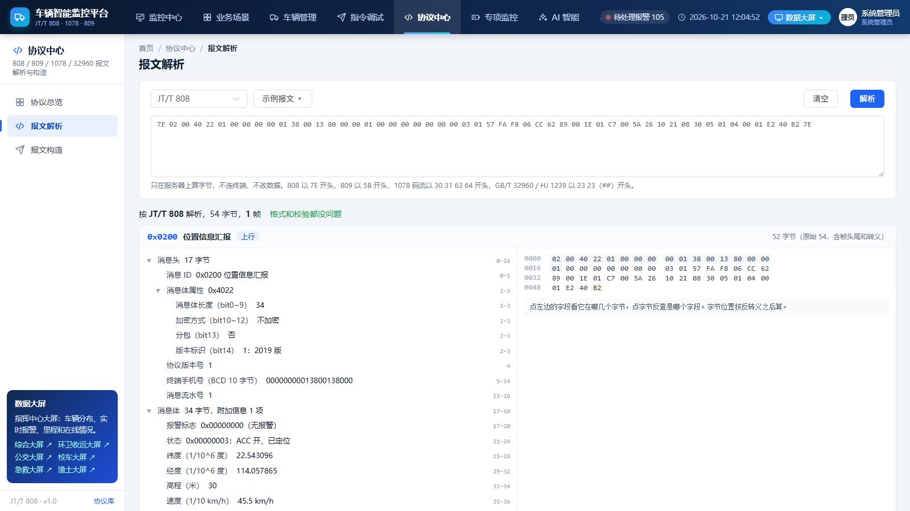

## 构建

```bash
git clone https://github.com/xiaowu-iot/iot-protocols.git
cd iot-protocols
mvn clean install
```

JDK 8 以上都能构建，产物在 JDK 8 上运行。

## 使用

还没有发布到 Maven 中央仓库，可以先 `mvn install` 到本地，或者通过 [JitPack](https://jitpack.io) 引用：

```xml
<repositories>
    <repository>
        <id>jitpack.io</id>
        <url>https://jitpack.io</url>
    </repository>
</repositories>

<dependency>
    <groupId>com.github.xiaowu-iot.iot-protocols</groupId>
    <artifactId>protocol-jt808</artifactId>
    <version>版本号（tag）</version>
</dependency>
```

0.x 版本接口可能还会调整，1.0 之后保持兼容。

## 工作流程

下面是各协议在这个库里的处理流程，类名、方法名和代码一致。图用 Mermaid 写，GitHub 上直接显示成图。

### 1. 总体分层

所有协议共用同一套底座：一条 TCP 连接进来，先经过底座的公共环节，再进各协议自己的切帧、解码和业务处理；平台下发指令走反方向，用"流水号 / 应答匹配"把异步的应答对回到调用方。

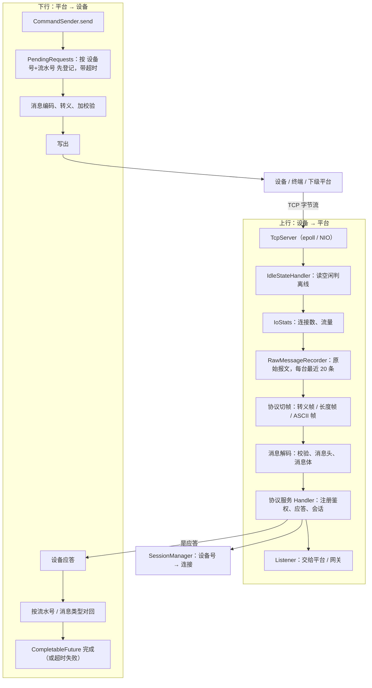

底座的几条通用规则：

- **坏数据不断连接**：校验错、长度不对的帧丢掉并计数（`CodecStats`），日志限流，连接保留。
- **半包粘包**：切帧器只认完整的帧，不完整的留在缓冲区里等下一次读；帧长有上限，超长直接丢。
- **会话**：鉴权（或第一条合法数据）之后才有会话；同一设备号在新连接上线时关闭旧连接。212 默认一条连接只认第一个通过校验的 MN，换了 MN 的数据直接丢弃（防冒用），可以关掉。
- **连接防护**：可以配总连接数、单个 IP 连接数的上限，超过的新连接直接断开；808 连上之后限定时间（默认 60 秒）内不鉴权就断开。
- **应答匹配**：下发时先登记再发送，应答按"设备号 + 流水号"（或按消息类型）对回；超时、发送失败都会让调用方立刻拿到结果。

### 2. JT/T 808

#### 2.1 终端接入时序

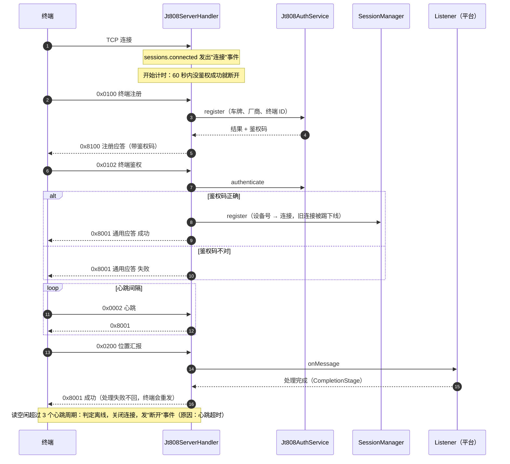

#### 2.2 上行解码流水线

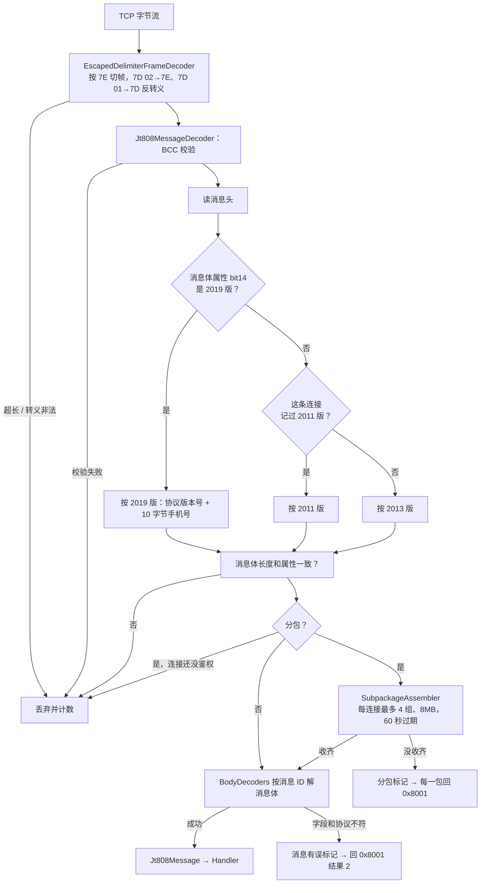

版本识别补充：2011 和 2013 版的消息头完全一样，只能靠注册消息 0x0100 的长度区分（2011 版的制造商 ID、终端型号更短）。认出 2011 版后记在连接上，之后这条连接的消息都按 2011 版解；终端重连后直接鉴权的，按注册时记在档案里的版本处理。

RSA 加密（消息体属性 bit10）：终端用 0x0A00 上报自己的公钥，平台回 0x8001 并用 0x8A00 下发平台公钥；之后终端发来的加密消息体用平台私钥解开，平台下发的消息可以选择用终端公钥加密（0x8A00 本身不加密）。RSA 1024、PKCS#1 填充，明文按 117 字节分块；标准没写死分块方式，对接前和终端厂家核对。平台密钥对要持久化保存。

#### 2.3 平台下发指令

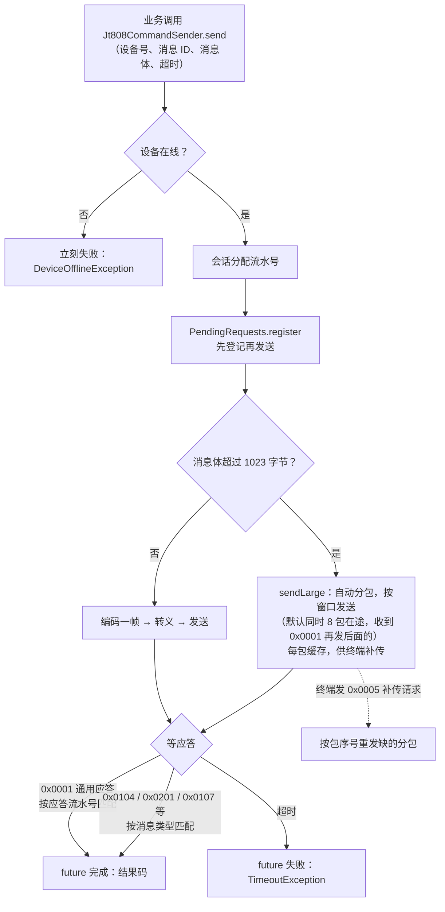

### 3. JT/T 1078 音视频

#### 3.1 组件

信令走 808 的连接，音视频走单独的媒体端口，两条路在平台的 `VideoService` 汇合。

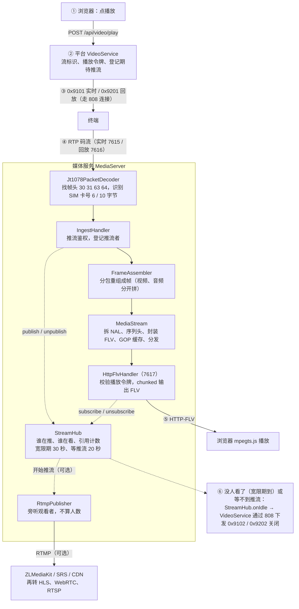

#### 3.2 实时视频时序

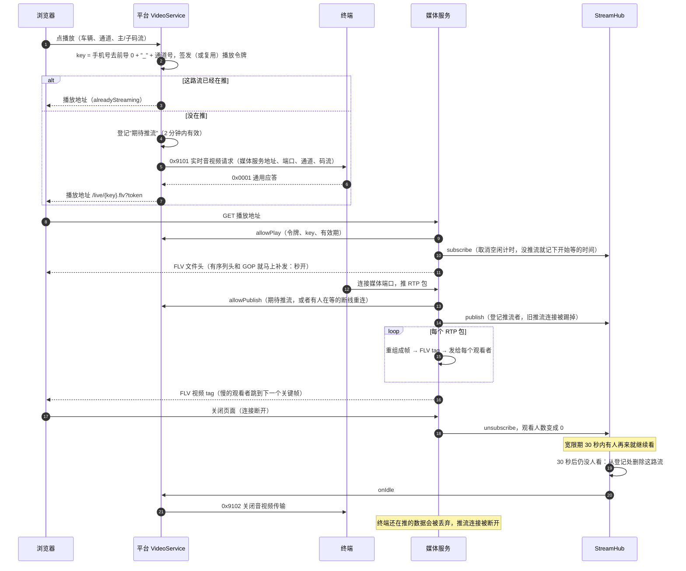

#### 3.3 一路流的生命周期

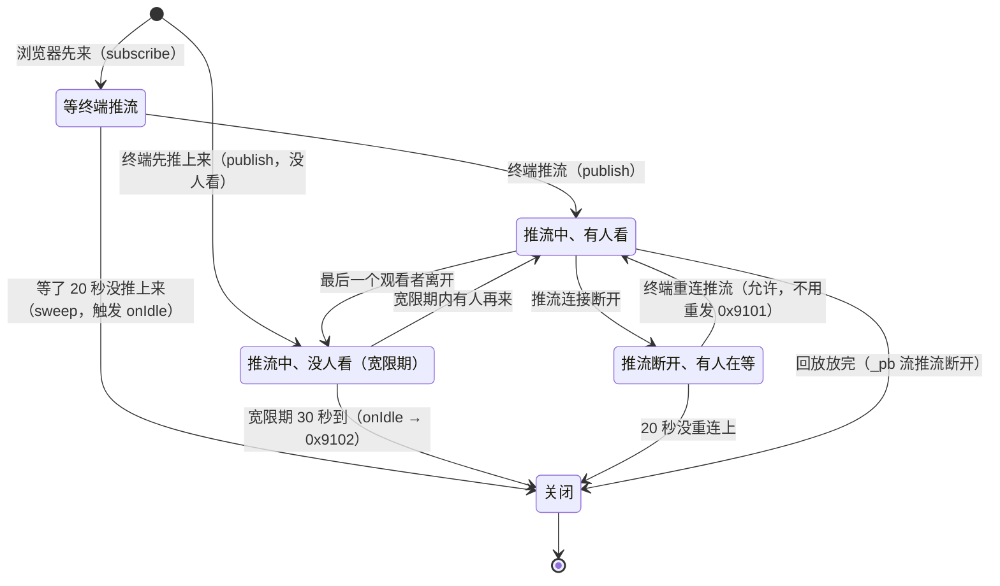

#### 3.4 一帧的处理（MediaStream.onFrame）

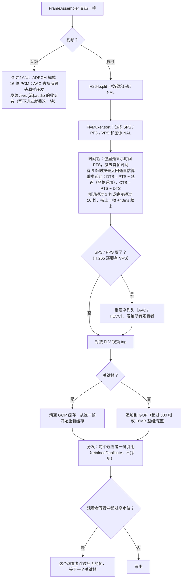

#### 3.5 录像回放的不同之处

- 先用 0x9205 查终端里的录像，终端用 0x1205 回资源列表（可能分包）。
- 回放下发 0x9201（推到回放端口 7616），流标识后面加 `_pb`，和同一通道的实时视频分开。
- 每次点回放都重新下发 0x9201；同一个 `_pb` 有新的推流连接时，旧的被踢掉。
- 终端放完这段录像会断开推流连接，平台随即结束这路流；没人看时下发 0x9202 停止回放。

#### 3.6 RTMP 转推（可选）

需要 HLS、WebRTC、RTSP，或者观众很多要走 CDN 时，不自己实现这些协议，把流用 RTMP 推给 ZLMediaKit、SRS 或 CDN，由它们分发。RTMP 客户端是自己写的（Netty，不引入新依赖）：

```java
RtmpRelay relay = RtmpRelay.template("rtmp://127.0.0.1:1935/live/{key}?secret=xxx");
hub.addPublishHook(relay::attach);   // 终端开始推流时自动转推，流关闭时跟着停
```

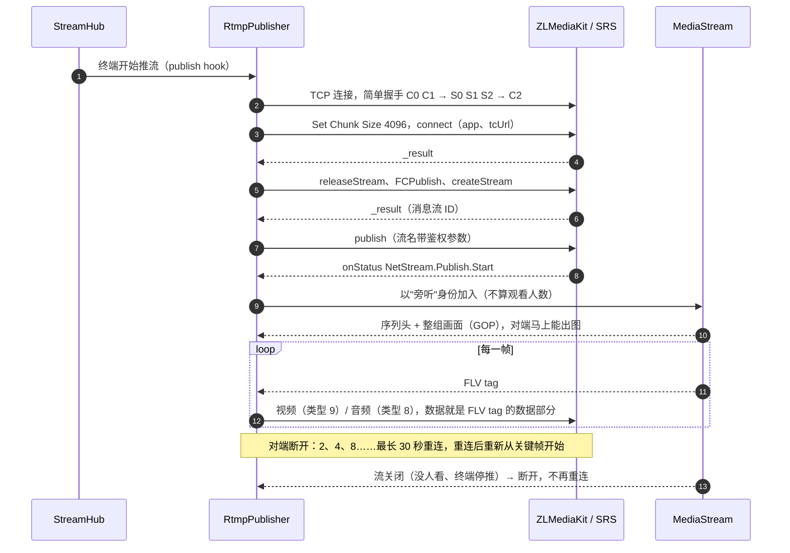

- 声音：G.711 原样发（FLV 编码 7 / 8，ZLMediaKit 支持），ADPCM 先解码再转成 G.711A，AAC 去掉 ADTS 头、先发 AudioSpecificConfig
- 转推跟着平台的按需拉流走：平台里有人看、终端在推才会转推；转推本身不让流一直开着
- 对端收得慢时丢帧到下一个关键帧，不影响平台自己的观看者
- 已和 ZLMediaKit（2026-10 master 版）联调：识别为 H.264 + PCMA，FLV、HLS 都能拉到，对端重启后几秒内自动重连。网页里的 FLV / HLS 播放器不认 G.711，播放 ZLMediaKit 的 FLV 时要设 `hasAudio: false`，要声音走 WebRTC；也可以 `RtmpRelay.setAudio(false)` 只推画面

### 4. HJ 212 污染物在线监测

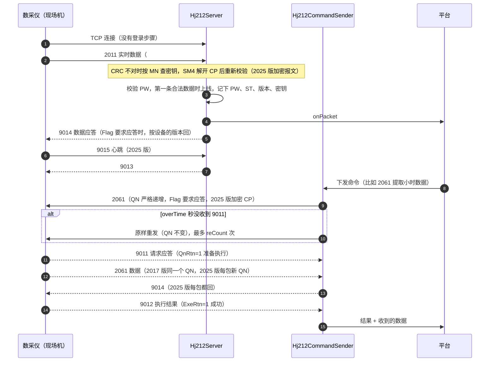

- 分包：2017 版按 MN / QN / CN 组包，PNUM 有上限，每台设备同时最多 8 组；2025 版逐包交出。每一包都回 9014。
- 2025 版加密：数据命令（2000~2999）、1014 更新密钥、3020 的 CP 用 SM4 加密，长度和 CRC 按明文算。
- 校时：现场机发 1013 请求校时，平台回 9013 后下发 1012，重发 1012 时换成当前时间。

### 5. SLP 智能储物柜 + 固件升级

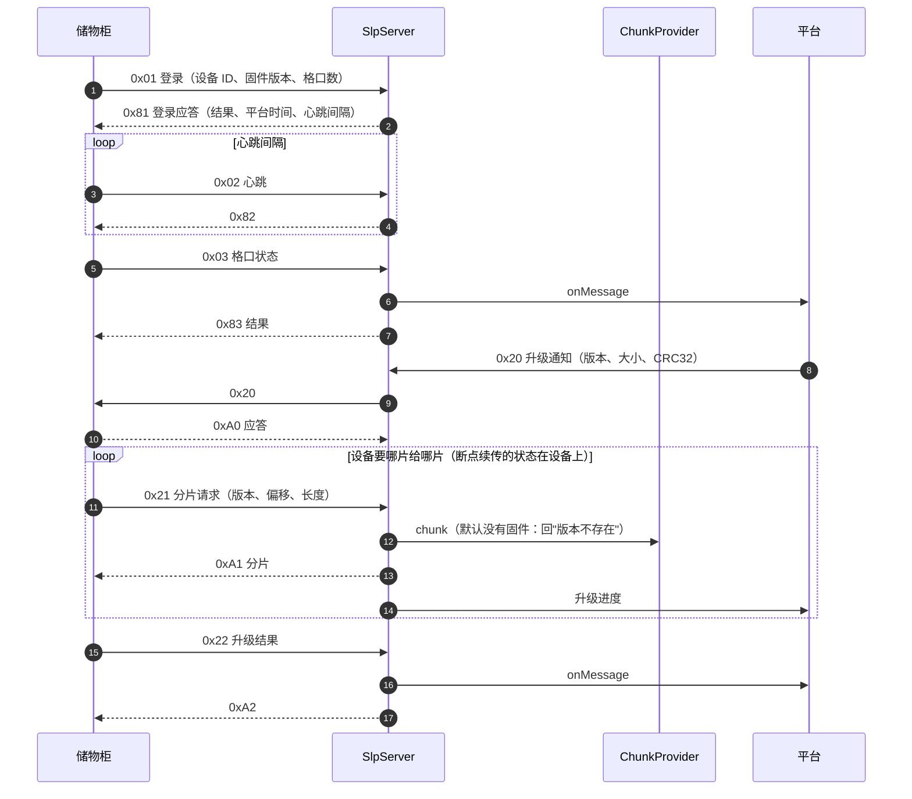

帧格式：`AA 55 | 版本 | 命令 | 流水号 | 设备 ID 8 | 长度 | 数据 | CRC16`，详见 [PROTOCOL.md](protocol-slp/PROTOCOL.md)。升级分片从 `SlpServer.ChunkProvider` 取，接自己的固件仓库实现这个接口就行。

### 6. 报文解析器（协议中心）

每个协议模块都有一个 `ProtocolInspector`，在 `META-INF/services` 登记。平台的"协议中心"用它解析和构造报文。

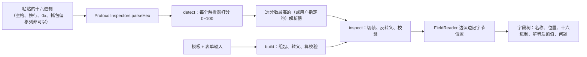

## 用这套协议库做的平台

### 车辆智能监控平台（jt-platform）

JT/T 808 全系列车辆监控平台，808、1078、809、主动安全、GB/T 32960、HJ 1239 的接入都用这个协议库。平台本身不开源，完整版源码在知识星球「小物学长的物联网实战营」：<https://t.zsxq.com/hldoY>

**综合大屏**：车辆分布、实时报警、里程排行、主动安全抓拍


**业务场景大屏**：同一套大屏框架，按场景换左右两栏和指标，大屏左上角可以切换

| 环卫收运：点位收运进度、漏收 | 公交：线路模拟图、到站准点率 |
|---|---|
| 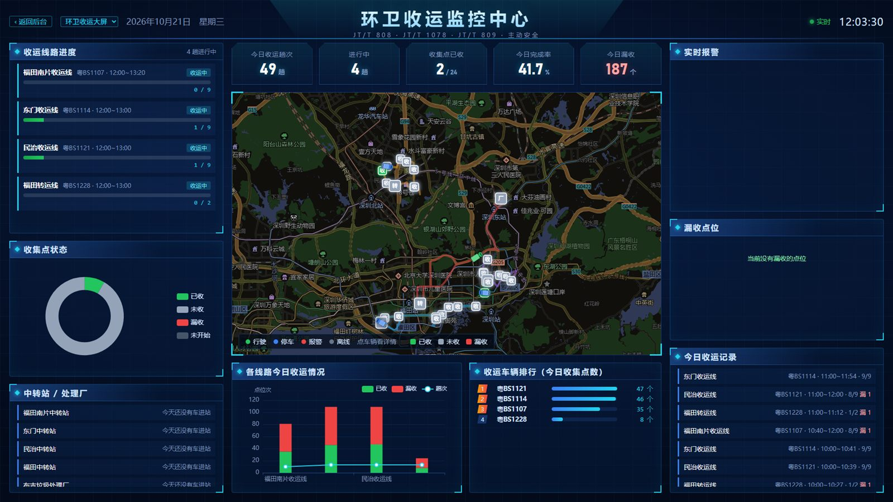 | 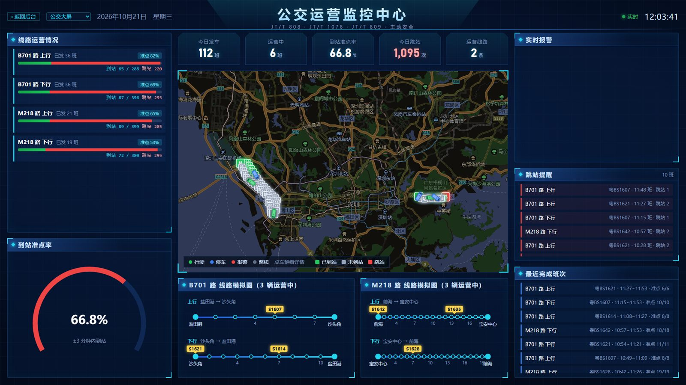 |
| **急救：进行中的任务、各环节用时** | **校车：乘车人数、到站准点（不显示学生姓名）** |
| 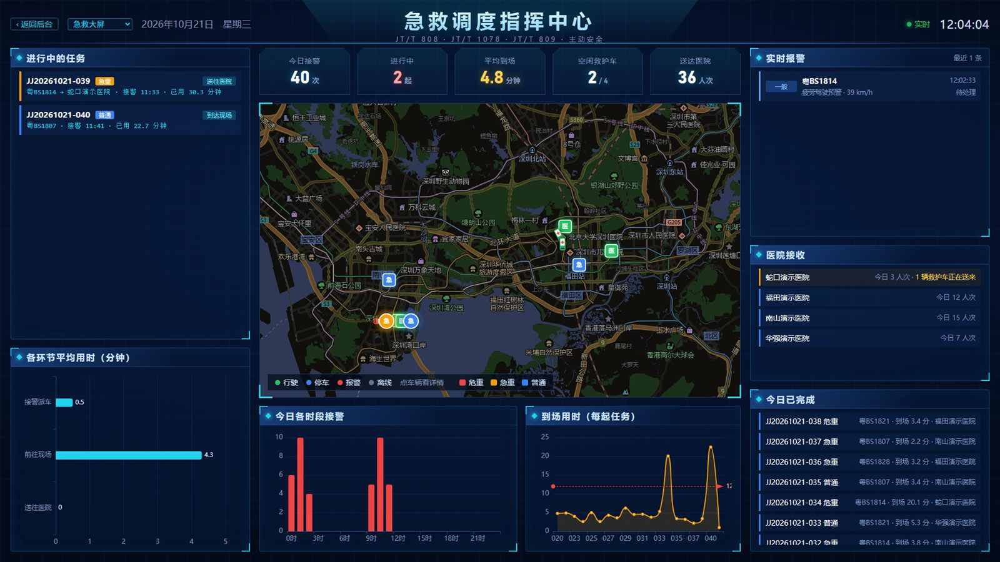 | 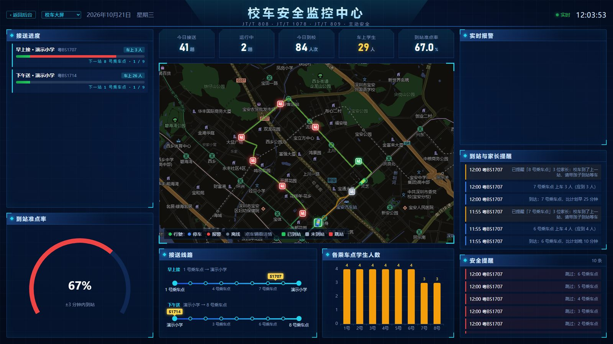 |

| 实时监控 | 实时视频（1078，多画面） |
|---|---|
|  | 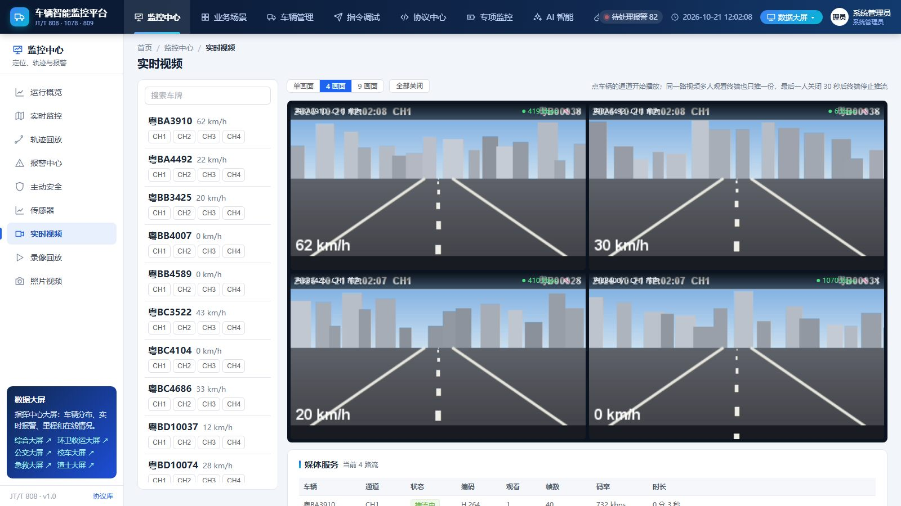 |
| **轨迹回放：超速分段着色、停留点** | **主动安全：ADAS / DSM 报警和附件** |
| 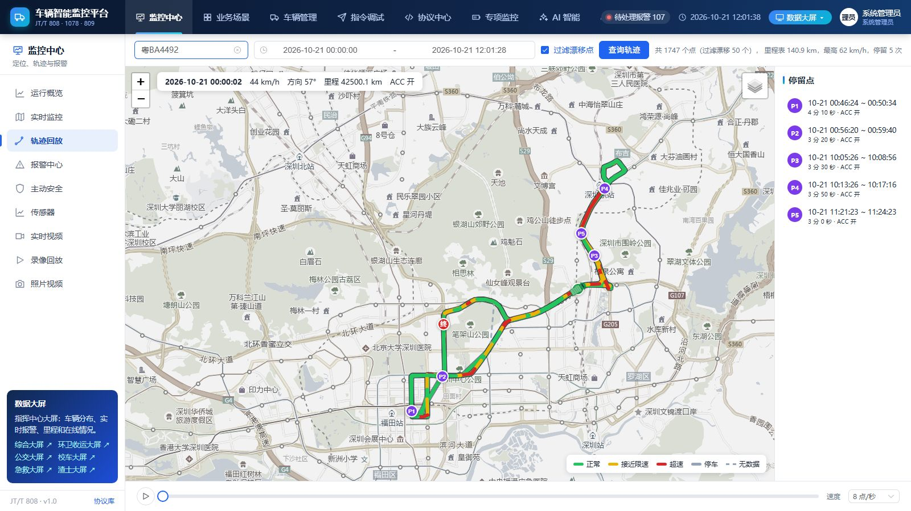 | 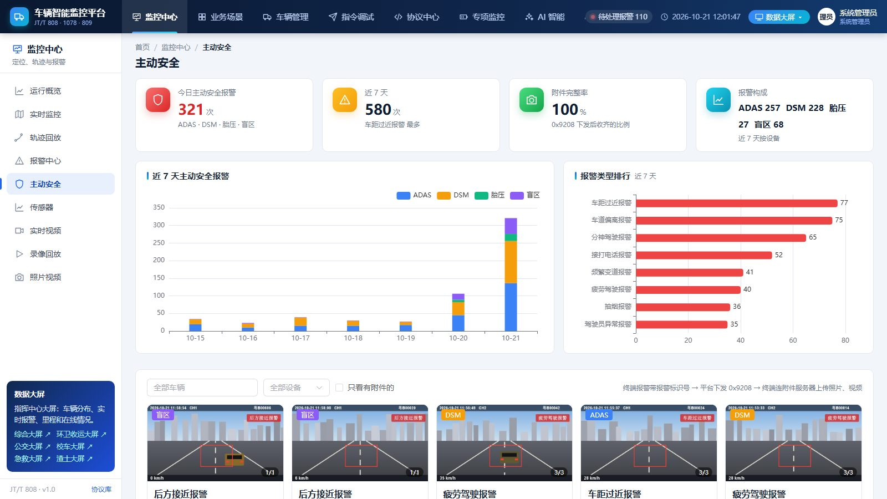 |

### 环境监测平台（env-monitor）

HJ212 环境在线监测平台，开源基础版在 <https://github.com/xiaowu-iot/env-monitor>，截图和在线演示见那个仓库。

## 许可证

[Apache License 2.0](LICENSE)
